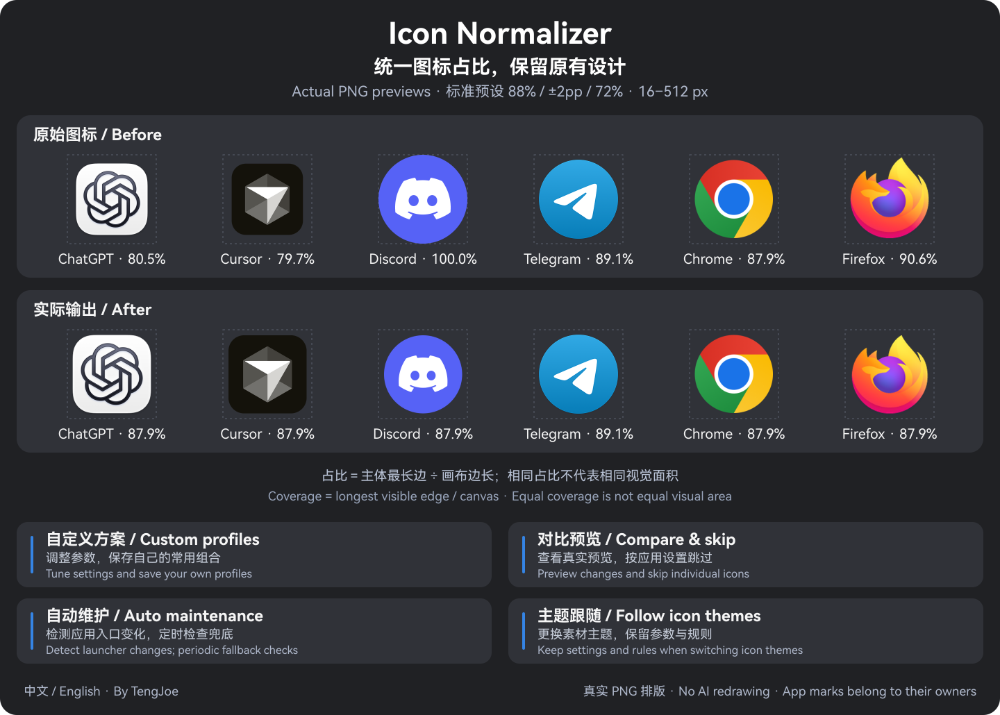

<div align="center">


# Icon Normalizer

**Consistent icon coverage. Original design preserved.**

Icon normalization, custom profiles, and automatic maintenance for GNOME.

[](https://github.com/TengJoe/icon-normalizer-plugin/releases/tag/v1.3.2)
[](#compatibility-and-dependencies)
[](#architecture)
[](README.md)
[](LICENSE)

[Download extension ZIP](https://github.com/TengJoe/icon-normalizer-plugin/releases/download/v1.3.2/icon-normalizer@joeydeng.local.zip) · [简体中文](README.md) · [Report an issue](https://github.com/TengJoe/icon-normalizer-plugin/issues)

</div>

**In one sentence:** icons in the dock and the app grid come from different design systems, so some hug the edges while others carry a lot of padding. Icon Normalizer brings each icon body to the same coverage (presets 83% / 88% / 92%) and adds a backplate to bare glyphs that lack one — **without touching the original artwork**.

<details>
<summary>How does this relate to Dash to Dock?</summary>

They complement each other and can run together. Dash to Dock manages **the dock itself** (position, autohide, appearance, blur); Icon Normalizer manages **the icon content** (coverage, backplate, nine sizes from 16 to 512 px).

No system icon file is modified: new artwork is generated in a dedicated theme named `DockNormalized`, originals stay read-only, and everything can be reverted.

</details>

## Architecture

Since 1.3.0 the entire pipeline runs as a **pure-GJS engine inside the extension process** — one ZIP installs everything, with no Python, Pillow, NumPy or systemd services required:

```text
┌─ GNOME Shell process ──────────────────────┐      ┌─ Prefs window (separate) ──┐
│  Panel indicator · pure-GJS engine          │      │  Gtk4 / Libadwaita          │
│  XDG resolve → analyze → Lanczos3 → commit  │      │  rules · preview · profiles │
└──────────────┬──────────────────────────────┘      └──────────┬─────────────────┘
               │      one shared sync.lock (flock)              │
               ▼                                                ▼
   ~/.local/share/icons/DockNormalized/        ~/.local/share/applications/*.desktop
   ~/.local/state/icon-normalizer/ (manifest · journal · backups · cache)
               ▲
   (optional) systemd user units: maintenance worker, sharing the same lock
```

- **Zero external dependencies**: decoding uses the GdkPixbuf that gnome-shell already links; resampling is a hand-written GJS Lanczos3 (premultiplied alpha) verified against the reference implementation with 144 pixel-level comparisons.
- **Transactions and rollback**: every write is an atomic tmp+rename guarded by digests; an interrupted transaction is rolled back from its journal, and external edits are strictly refused, never clobbered.
- **Single-writer mutual exclusion**: Shell, prefs window and the optional worker serialize on one `sync.lock` (flock); contention surfaces as a retryable BUSY.
- **The main loop never freezes**: bulk analysis/rendering is sliced across idle callbacks, so the desktop stays interactive.

## Preview



*Real PNG layout, no AI re-rendering. Standard preset: 88% target coverage, ±2 percentage points deadband, 72% glyph inner coverage.*

<details>
<summary>Why can circles and squares still look different in size after normalization?</summary>

The algorithm normalizes the **longest edge of the icon body as a share of the canvas**; it does not promise equal visual area or visual weight for every shape. Inner padding inside existing backplates is preserved.

Both rows in the image use the same canvas size. ChatGPT and Cursor are enlarged, Discord and Firefox are shrunk; Telegram and Chrome are already within the deadband and stay as-is. Application icons and trademarks belong to their respective owners and do not imply endorsement.

</details>

## Features

<table>
<tr>
<td width="50%" valign="top"><strong>Icon normalization</strong><br>Adjusts body coverage, adds backplates (including rounded plates), and generates nine sizes from 16 to 512 px.</td>
<td width="50%" valign="top"><strong>Custom profiles</strong><br>Tune target, deadband and inner coverage; store up to 50 named profiles.</td>
</tr>
<tr>
<td valign="top"><strong>Per-app management</strong><br>Search, filter, compare previews, and set skip or classification rules per icon.</td>
<td valign="top"><strong>Automatic maintenance and theme following</strong><br>Detects desktop entry changes; keeps parameters and per-icon rules when the source theme changes.</td>
</tr>
<tr>
<td valign="top"><strong>Visible, repairable rule states</strong><br>Every icon reports its classification origin (automatic / user rule / reviewed); stale rules raise warnings and reset in one click, and rules follow apps across size directories.</td>
<td valign="top"><strong>Concurrency safety and responsiveness</strong><br>Cross-process flock serialization plus journal-based safe rollback; bulk rendering is idle-sliced so the desktop never freezes.</td>
</tr>
<tr>
<td valign="top"><strong>Health diagnostics and safe recovery</strong><br>Shows faults with localized details; restores managed changes and stops rather than overwriting external edits.</td>
<td valign="top"><strong>Adaptive Chinese/English UI</strong><br>Fits narrow and wide windows; switching language keeps the page, search and unsaved drafts.</td>
</tr>
</table>

## Quick start

Requires **GNOME Shell 51**. The extension has zero dependencies — one ZIP is all it takes.

### Option 1: install the extension (recommended)

Click "Install" on GNOME Extensions (extensions.gnome.org) — **under review** at the moment; one-click install will be available once approved.

Or download the [extension ZIP](https://github.com/TengJoe/icon-normalizer-plugin/releases/download/v1.3.2/icon-normalizer@joeydeng.local.zip) and install it the standard way:

```bash
gnome-extensions install --force icon-normalizer@joeydeng.local.zip
gnome-extensions enable icon-normalizer@joeydeng.local
```

ZIPs built from source need the schema compiled first (release packages and the installer do this automatically):

```bash
glib-compile-schemas ~/.local/share/gnome-shell/extensions/icon-normalizer@joeydeng.local/schemas
```

Then open **Icon Normalizer → Settings** from Extensions and click "Apply" to generate and activate the normalized theme.

### Option 2: offline complete package

1. Download the [complete package](https://github.com/TengJoe/icon-normalizer-plugin/releases/download/v1.3.2/icon-normalizer-plugin-1.3.2.tar.gz) and [SHA256SUMS](https://github.com/TengJoe/icon-normalizer-plugin/releases/download/v1.3.2/SHA256SUMS) into the same directory.
2. Verify, extract and install:

```bash
sha256sum --ignore-missing -c SHA256SUMS
tar -xzf icon-normalizer-plugin-1.3.2.tar.gz
cd icon-normalizer-plugin
python3 tools/install.py
```

The installer snapshots, stages and validates files, swaps the code and probes the service; a failed upgrade restores the snapshot. **No `sudo` is used** — everything lives in your home directory.

### Optional: automated maintenance worker

Without the worker the extension is fully functional. Installing the optional companion adds **systemd-grade automation** — watching application directories and refreshing on a timer — sharing the same lock with the extension:

```bash
curl -fsSL https://raw.githubusercontent.com/TengJoe/icon-normalizer-plugin/main/install.sh | bash
```

Dependency check only: `... | bash -s -- --check`.

<details>
<summary>Install from source</summary>

```bash
git clone https://github.com/TengJoe/icon-normalizer-plugin.git
cd icon-normalizer-plugin
python3 tools/build.py
python3 tools/install.py
```

Build outputs land in `dist/`: the extension ZIP, the complete source package and `DIST_MANIFEST.json`. See the [contributing guide](CONTRIBUTING.md) for development checks.

</details>

> Current GitHub release: extension **1.3.2** (companion **3.1.20**, optional). `main` may contain unreleased changes; see the [changelog](CHANGELOG.md) for version scope. After a panel-code upgrade, log out and back in to refresh the GNOME Shell module cache.

## Usage

| Page | What you can do |
| --- | --- |
| **Rules** | Tune parameters, pick presets or named profiles; view and edit per-icon rules (change class / reset to automatic) |
| **App icons** | Search, filter (including "has rule"), compare original and candidate previews, manage per-icon skip rules |
| **Maintenance** | Check status, apply and activate now, toggle automatic maintenance, theme following, language and the panel button |

**Suggested order: preview → tune → save and apply.** The standard preset is **88% / ±2 points / 72%**, with output sizes `16 / 24 / 32 / 48 / 64 / 96 / 128 / 256 / 512 px`.

<details>
<summary>How do custom profiles take effect?</summary>

"Save as custom profile" stores the current parameters; "Use profile" only fills the draft. Parameters become the effective configuration only after "Save" or "Save and apply". Named profiles are not bound to an icon theme.

</details>

<details>
<summary>What happens when I switch themes, install apps, or close the window?</summary>

"Maintenance → Follow icon theme" is on by default. Switching to another installed source theme regenerates `DockNormalized`, keeping parameters and per-icon rules.

While the extension is enabled, the standard Yaru GTK theme follows the system light/dark style and accent color; custom GTK themes stay manual. When `DockNormalized` is active with theme following enabled, the standard Yaru icon source follows the accent color and light/dark style too, choosing only installed variants.

Automatic maintenance detects desktop entry changes and refreshes incrementally; regeneration only touches icons that changed, reusing everything already generated.

</details>

<details>
<summary>An app changed its icon and my rule went stale — now what?</summary>

Rules are bound to the source artwork fingerprint. When an app updates its icon, the rule goes stale and falls back to automatic classification — **never silently**:

- The maintenance page shows "N icon rules have gone stale", with per-icon details and a one-click reset to automatic;
- The panel indicator (when enabled) sends one desktop notification, controllable via "Notify me about stale rules"; the same issue is not repeated;
- Apps that merely moved their artwork to another size directory keep their rules automatically;
- Square full-bleed plates can be switched to `plate-rounded` (the preview dialog suggests it).

Command-line checks: `rules_health` in `status`, `checks.rules` in `doctor`; see [docs/MAINTENANCE.md](docs/MAINTENANCE.md).

</details>

<details>
<summary>Where are the UI language and panel entry?</summary>

Pick "Follow system", "简体中文" or "English" under "Maintenance → UI language". The panel and settings share the language preference; switching updates both immediately.

The panel button is off by default. Enable "Show panel button" under "Maintenance" to check status, apply icons and open settings from a monochrome icon.

</details>

## Compatibility and dependencies

Only **GNOME Shell 51** is declared, as runtime-verified; other versions need separate validation.

| Component | Dependencies |
| --- | --- |
| Extension (engine + panel) | None beyond GNOME 51 itself: GJS and GdkPixbuf ship with it |
| Settings window | GTK 4, Libadwaita and their GI typelibs |
| Optional maintenance worker | Python 3.10+, a systemd user session |
| Build and install | `gtk-update-icon-cache`, `glib-compile-schemas` |

- Tray/AppIndicator icons, and window icons drawn or loaded directly by apps, may bypass icon themes.
- A non-default `XDG_DATA_HOME` is not supported; the install check refuses that environment.
- Downloading from GitHub or installing locally does not imply GNOME Extensions approval; the review scope is described in [docs/SUBMISSION.md](docs/SUBMISSION.md).

## Quality and safety

- **20 quality gates** in one command (`bash tools/verify.sh`): 253 backend tests, 5 frontend suites, **69 GJS engine unit tests**, a **UI payload contract suite** (Q20: every operation the interface invokes must have a test case written with the exact payload the UI constructs, so implementation and tests can no longer be wrong together), and cross-implementation parity — **144 render + 69 analysis** pixel comparisons against the Python reference.
- **No network, no telemetry**: the tree contains no networking code; release artifacts are readable GJS/SVG/CSS — no binaries, no minification.
- **Privacy audit**: `tools/privacy_audit.py` pattern-scans the release allowlist (secrets, personal paths, emails, image metadata, tar headers) with zero findings.
- **Reproducible builds**: fixed timestamps and permissions; consecutive builds are byte-identical to the published assets.

## Recovery and removal

Click "Restore" under "Maintenance → Restore desktop icons" and confirm to revert managed changes and the most recently selected source theme. Managed launchers untouched by external edits are restored byte-for-byte; on conflict the external change is kept and the failure reported.

From the complete package or a source checkout:

```bash
# Restore managed changes first, then remove the extension and the worker.
python3 tools/uninstall.py

# Remove only the extension, keep the worker and automation.
python3 tools/uninstall.py --keep-backend
```

Backups are kept in `~/.local/state/icon-normalizer/backups/`. If a restore fails, state files and managed directories are preserved; follow the [acceptance and recovery notes](docs/CHECKLIST.md).

## Developer documentation

| Document | Contents |
| --- | --- |
| [Architecture](ARCHITECTURE.md) | Module responsibilities, process isolation, transactions and data flow |
| [ADR-0008](docs/adr/0008-gjs-only-engine.md) | The pure-GJS in-process engine: decision and trade-offs |
| [Protocol](PROTOCOL.md) | JSON requests, error codes and concurrency control |
| [Contributing](CONTRIBUTING.md) | Development checks, feedback requirements, bilingual writing rules |
| [Release checklist](docs/CHECKLIST.md) | Automated checks, desktop acceptance and recovery steps |
| [Changelog](CHANGELOG.md) | Version history; [v1.3.2 notes](docs/RELEASE-1.3.2.md) |

More material is indexed in the [documentation index](docs/README.md). When reporting an issue, include system and component versions and reproduction steps, and strip private information from logs and screenshots first.

## Author

Developed by **[TengJoe](https://github.com/TengJoe)** under the [GPL-3.0-or-later](LICENSE) license. All features are free to use.

[Report an issue](https://github.com/TengJoe/icon-normalizer-plugin/issues) · [Contribute](CONTRIBUTING.md)
