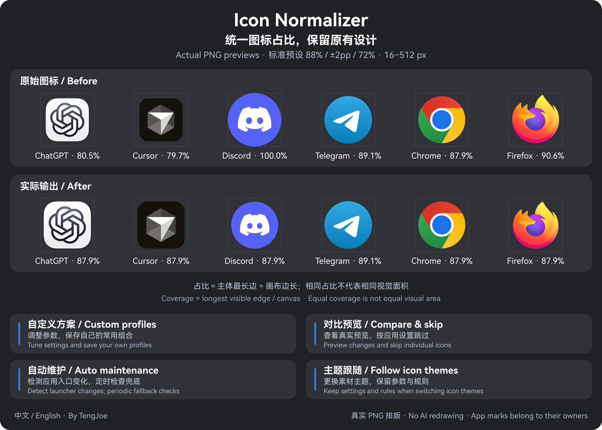

<div align="center">


# Icon Normalizer

**统一图标占比，保留原有设计。**

为 GNOME 桌面提供图标归一化、自定义方案与自动维护。

[](https://github.com/TengJoe/icon-normalizer-plugin/releases/tag/v1.3.1)
[](#兼容与依赖)
[](#架构)
[](README.en.md)
[](LICENSE)

[下载扩展 ZIP](https://github.com/TengJoe/icon-normalizer-plugin/releases/download/v1.3.1/icon-normalizer@joeydeng.local.zip) · [English](README.en.md) · [问题反馈](https://github.com/TengJoe/icon-normalizer-plugin/issues)

</div>

**一句话**：Dock 和应用程序网格里的图标，有的贴边、有的留白很大，看上去大小不一。Icon Normalizer 把每个图标的主体统一到同一占比（预设 83% / 88% / 92%），并为缺少底板的裸 Logo 补上底板 —— **不修改任何原图**。

<details>
<summary>和 Dash to Dock 有什么区别？</summary>

两者互补，可以同时启用：Dash to Dock 管理 **Dock 本身**（位置、自动隐藏、外观、模糊），Icon Normalizer 管理 **图标内容**（主体占比、底板、16–512 px 九档尺寸）。

Icon Normalizer 不改任何系统图标文件：它在专属主题 `DockNormalized` 里生成新图，原始图标只读，随时可还原。

</details>

## 架构

自 1.3.0 起，全部工作由 **扩展进程内的纯 GJS 引擎** 完成 —— 一个 ZIP 装完即用，无需 Python、Pillow、NumPy 或 systemd 服务：

```text
┌─ GNOME Shell 进程 ─────────────────────────┐      ┌─ 设置窗口（独立进程）─┐
│  顶栏指示器 · 纯 GJS 引擎                    │      │  Gtk4 / Libadwaita    │
│  XDG 解析 → 分析 → Lanczos3 渲染 → 事务落盘  │      │  规则 · 预览 · 方案    │
└──────────────┬─────────────────────────────┘      └──────────┬────────────┘
               │        共用一把 sync.lock（flock 互斥）         │
               ▼                                               ▼
   ~/.local/share/icons/DockNormalized/        ~/.local/share/applications/*.desktop
   ~/.local/state/icon-normalizer/（manifest · 事务日志 · 备份 · 缓存）
               ▲
   （可选）systemd 用户单元：自动维护 worker，与应用目录监视共用同一把锁
```

- **零外部依赖**：图标解码交给 GNOME 自带的 GdkPixbuf，重采样为自研 GJS Lanczos3（alpha 预乘），与参考实现经 144 组逐像素对拍验证。
- **事务与回滚**：所有写入走 tmp+rename 原子替换与摘要守卫；中断事务按日志回滚，且严格拒绝覆盖外部修改。
- **单写者互斥**：Shell、设置窗口与可选后台共用一把 `sync.lock`（flock），争用时返回可重试的 BUSY。
- **主线程不冻结**：批量分析/渲染按 idle 时间片切片，桌面始终保持可交互。

## 效果预览



*真实 PNG 排版，无 AI 重绘。示例使用标准预设：88% 目标占比、±2 个百分点容差、72% Logo 内层占比。*

<details>
<summary>为什么统一后，圆形和方形仍可能看起来不一样大？</summary>

当前算法统一的是**主体最长边占画布的比例**，不保证所有形状拥有相同的视觉面积或视觉重量。已有底板图标的内部留白也会保留。

图中两排使用相同大小的画布。ChatGPT、Cursor 放大，Discord、Firefox 缩小；Telegram、Chrome 已在容差范围内，保持原样。图中的应用图标与商标归各自权利人所有，不表示第三方认可或背书。

</details>

## 功能

<table>
<tr>
<td width="50%" valign="top"><strong>图标归一化</strong><br>调整主体占比，按需补充底板（含圆角底板），生成 16–512 px 九档图标。</td>
<td width="50%" valign="top"><strong>自定义方案</strong><br>调整目标、容差和内层参数，保存最多 50 套命名方案。</td>
</tr>
<tr>
<td valign="top"><strong>逐应用管理</strong><br>搜索、筛选、查看对比预览，为单个图标设置跳过或分类规则。</td>
<td valign="top"><strong>自动维护与主题跟随</strong><br>检测应用入口变化；更换素材主题时保留参数与逐图标规则。</td>
</tr>
<tr>
<td valign="top"><strong>规则状态可见可修</strong><br>每个图标标注分类来源（自动 / 用户规则 / 已复核）；规则失效时告警并可一键重置，跨尺寸目录自动接续。</td>
<td valign="top"><strong>并发安全与防冻结</strong><br>跨进程 flock 互斥 + 事务日志安全回滚；批量渲染按 idle 时间片切片，桌面不冻结。</td>
</tr>
<tr>
<td valign="top"><strong>健康诊断与安全恢复</strong><br>显示故障与中英文详情；还原托管修改，遇到外部编辑时停止覆盖。</td>
<td valign="top"><strong>自适应中英文界面</strong><br>适配宽窄窗口，即时切换语言并保留页面、搜索与未保存草稿。</td>
</tr>
</table>

## 快速开始

需要 **GNOME Shell 51**。扩展零依赖，一个 ZIP 装完即用。

### 方式一：安装扩展（推荐）

在 GNOME 扩展网站（extensions.gnome.org）点「Install」—— 目前**审核中**，通过后即可一键安装。

或者下载 [扩展 ZIP](https://github.com/TengJoe/icon-normalizer-plugin/releases/download/v1.3.1/icon-normalizer@joeydeng.local.zip) 后按标准方式安装：

```bash
gnome-extensions install --force icon-normalizer@joeydeng.local.zip
gnome-extensions enable icon-normalizer@joeydeng.local
```

源码构建的 ZIP 需先编译 schema（完整发行包和安装器会自动处理）：

```bash
glib-compile-schemas ~/.local/share/gnome-shell/extensions/icon-normalizer@joeydeng.local/schemas
```

安装后从扩展管理器打开 **Icon Normalizer → 设置**，点「立即应用」即可生成并激活归一化主题。

### 方式二：离线完整包

1. 下载 [完整安装包](https://github.com/TengJoe/icon-normalizer-plugin/releases/download/v1.3.1/icon-normalizer-plugin-1.3.1.tar.gz) 与 [SHA256SUMS](https://github.com/TengJoe/icon-normalizer-plugin/releases/download/v1.3.1/SHA256SUMS)，放在同一目录。
2. 校验后解压安装：

```bash
sha256sum --ignore-missing -c SHA256SUMS
tar -xzf icon-normalizer-plugin-1.3.1.tar.gz
cd icon-normalizer-plugin
python3 tools/install.py
```

安装器会创建快照、暂存并验证文件、替换代码和探活；升级失败时恢复快照。**不使用 `sudo`**，所有文件都在你的主目录。

### 可选：自动维护后台

不装后台，扩展照常完整工作；安装可选后台可获得 **systemd 级自动维护**——监视应用目录变化、定时兜底刷新，与扩展共用同一把锁：

```bash
curl -fsSL https://raw.githubusercontent.com/TengJoe/icon-normalizer-plugin/main/install.sh | bash
```

只检查依赖：`... | bash -s -- --check`。

<details>
<summary>从源码安装</summary>

```bash
git clone https://github.com/TengJoe/icon-normalizer-plugin.git
cd icon-normalizer-plugin
python3 tools/build.py
python3 tools/install.py
```

构建产物位于 `dist/`：扩展 ZIP、完整源码包和 `DIST_MANIFEST.json`。开发检查见[贡献指南](CONTRIBUTING.md)。

</details>

> 当前 GitHub 发行版：扩展 **1.3.1**（后台 **3.1.20**，可选）。`main` 可能包含未发布变更；版本范围见[发布记录](CHANGELOG.md)。顶栏代码升级后需要注销、重新登录以刷新 GNOME Shell 模块缓存。

## 使用说明

| 页面 | 可以做什么 |
| --- | --- |
| **规则** | 调整参数、选择预设或命名方案；查看并编辑逐图标规则（改类别 / 重置为自动） |
| **应用图标** | 搜索、筛选（含“有规则”）、查看原始与候选预览，管理逐图标跳过规则 |
| **维护** | 查看状态、立即检查或应用并激活主题，设置自动维护、主题跟随、语言与顶栏按钮 |

**建议顺序：查看预览 → 调整参数 → 保存并应用。** 标准预设为 **88% / ±2 个百分点 / 72%**，输出尺寸为 `16 / 24 / 32 / 48 / 64 / 96 / 128 / 256 / 512 px`。

<details>
<summary>自定义方案怎样生效？</summary>

“保存为自定义方案”存储当前参数；“使用方案”只填入草稿。点击“仅保存”或“保存并应用”后，参数才成为生效配置。命名方案不绑定图标主题。

</details>

<details>
<summary>换主题、新装应用或关闭窗口后会怎样？</summary>

“维护 → 跟随图标主题”默认开启。切换到另一个已安装的素材主题会重新生成 `DockNormalized`，保留参数与逐图标规则。

扩展启用时，标准 Yaru GTK 主题跟随系统深浅色和强调色，自定义 GTK 主题保持手动选择。`DockNormalized` 激活且主题跟随开启时，标准 Yaru 图标来源也跟随强调色与深浅色，只选择已安装变体。

自动维护（扩展内置或可选后台）检测应用入口变化后增量刷新；重新生成只处理有变化的图标，已生成的直接复用。

</details>

<details>
<summary>应用换了图标，我之前设的规则失效了怎么办？</summary>

规则按源图指纹绑定。应用更新图标后指纹变化，规则会失效并退回自动分类 —— 这件事**不静默**：

- 维护页顶部出现“检测到 N 条图标规则已失效”提示，可逐条查看并**一键重置为自动**；
- 顶栏指示器（开启时）发送一次桌面通知，可在“维护 → 规则失效时通知我”关闭，同一问题不会重复提醒；
- 只是换尺寸目录的情况会自动按文件名接续，无需处理；
- 满幅直角底板可改为 `plate-rounded`（预览弹窗会给出建议）。

命令行排查：`status` 的 `rules_health`、`doctor` 的 `checks.rules`，详见 [docs/MAINTENANCE.md](docs/MAINTENANCE.md)。

</details>

<details>
<summary>界面语言和顶栏入口在哪里？</summary>

在“维护 → 界面语言”选择“跟随系统”“简体中文”或“English”。顶栏与设置共用语言偏好，切换后即时更新。

顶栏按钮默认关闭。在“维护 → 显示顶栏按钮”开启后，可通过单色图标查看状态、检查或应用图标，以及打开设置。

</details>

## 兼容与依赖

仅声明经过运行时验收的 **GNOME Shell 51**；其他版本需要单独验证。

| 组件 | 依赖 |
| --- | --- |
| 扩展（引擎 + 顶栏） | 无额外依赖：GJS、GdkPixbuf 均为 GNOME 51 自带 |
| 设置窗口 | GTK 4、Libadwaita 及对应 GI 类型库 |
| 可选自动维护后台 | Python 3.10+、systemd 用户会话 |
| 构建与安装 | `gtk-update-icon-cache`、`glib-compile-schemas` |

- 托盘、AppIndicator，以及应用直接绘制或从文件加载的窗口图标，可能绕过图标主题。
- 非默认 `XDG_DATA_HOME` 暂不支持，安装检查会拒绝该环境。
- GitHub 下载与本地安装不代表 GNOME 商店审核通过；审核范围见[提交说明](docs/SUBMISSION.md)。

## 质量与安全

- **19 道质量门**一条命令全量回归（`bash tools/verify.sh`）：后端 253 项测试、前端 5 组套件、**69 项 GJS 引擎单测**、**144 组渲染 + 69 组分析**的 GJS vs Python 跨实现逐像素对拍。
- **无网络、无遥测**：全仓不含任何网络请求代码；发布物为可读 GJS/SVG/CSS，无二进制、无压缩混淆。
- **隐私审计**：`tools/privacy_audit.py` 对发布允许清单做模式扫描（密钥、个人路径、邮箱、图片元数据、tar 头账号信息），0 发现。
- **构建可复现**：固定时间戳与权限的构建脚本，两次构建与发布资产逐字节一致。

## 恢复与卸载

在“维护 → 还原桌面图标”点击“还原”并确认，可恢复托管修改与最近选择的素材主题。未被外部编辑的托管启动器按原始字节还原；发生冲突时保留外部修改并报告失败。

在完整发行包或源码目录执行：

```bash
# 先恢复托管修改，再卸载扩展与后台。
python3 tools/uninstall.py

# 仅移除扩展，保留后台与自动维护。
python3 tools/uninstall.py --keep-backend
```

备份保留在 `~/.local/state/icon-normalizer/backups/`。恢复失败时保留状态文件与托管目录，按[验收与恢复说明](docs/CHECKLIST.md)处理。

## 开发文档

| 文档 | 内容 |
| --- | --- |
| [架构说明](ARCHITECTURE.md) | 模块职责、进程隔离、事务与数据流 |
| [ADR-0008](docs/adr/0008-gjs-only-engine.md) | 纯 GJS 内嵌引擎的架构决策与取舍 |
| [协议规范](PROTOCOL.md) | JSON 请求、错误码与并发控制 |
| [贡献指南](CONTRIBUTING.md) | 开发检查、反馈要求与双语写作规范 |
| [发布验收](docs/CHECKLIST.md) | 自动检查、桌面验收与恢复步骤 |
| [版本记录](CHANGELOG.md) | 历史版本；[v1.3.1 说明](docs/RELEASE-1.3.1.md) |

更多资料见[文档索引](docs/README.md)。报告问题时，请附系统与组件版本、复现步骤，并先去除日志或截图中的私人信息。

## 作者

由 **[TengJoe](https://github.com/TengJoe)** 开发，使用 [GPL-3.0-or-later](LICENSE) 许可证。所有功能均可免费使用。

[反馈问题](https://github.com/TengJoe/icon-normalizer-plugin/issues) · [贡献代码](CONTRIBUTING.md)
