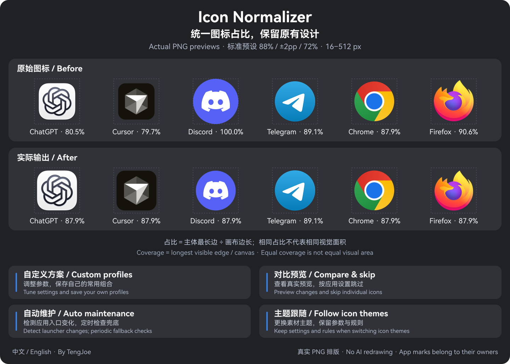

<div align="center">


# Icon Normalizer

**统一图标占比，保留原有设计。**

为 GNOME 桌面提供图标归一化、自定义方案与自动维护。

[](https://github.com/TengJoe/icon-normalizer-plugin/releases/tag/v1.1.3)
[](#兼容与依赖)
[](README.en.md)
[](LICENSE)

[下载完整安装包](https://github.com/TengJoe/icon-normalizer-plugin/releases/download/v1.1.3/icon-normalizer-plugin-1.1.3.tar.gz) · [English](README.en.md) · [问题反馈](https://github.com/TengJoe/icon-normalizer-plugin/issues) · [支持开发](docs/SUPPORT.md)

</div>

---

[效果预览](#效果预览) · [功能](#功能) · [快速开始](#快速开始) · [使用说明](#使用说明) · [恢复与卸载](#恢复与卸载) · [开发文档](#开发文档)

## 效果预览

Icon Normalizer 由 GNOME Shell 扩展和用户级 Python 后台组成：调整应用图标的主体占比，为适合的裸 Logo 补充底板，并在应用或图标主题变化后维护生成结果。原始系统图标只读，生成文件与恢复记录保存在用户目录。



*真实 PNG 排版，无 AI 重绘。示例使用标准预设：88% 目标占比、±2 个百分点容差、72% Logo 内层占比。*

<details>
<summary>为什么统一后，圆形和方形仍可能看起来不一样大？</summary>

当前算法统一的是**主体最长边占画布的比例**，不保证所有形状拥有相同的视觉面积或视觉重量。已有底板图标的内部留白也会保留。

图中两排使用相同大小的画布。ChatGPT、Cursor 放大，Discord、Firefox 缩小；Telegram、Chrome 已在容差范围内，保持原样。图中的应用图标与商标归各自权利人所有，不表示第三方认可或背书。

</details>

## 功能

<table>
<tr>
<td width="50%" valign="top"><strong>图标归一化</strong><br>调整主体占比，按需补充底板，生成 16–512 px 九档图标。</td>
<td width="50%" valign="top"><strong>自定义方案</strong><br>调整目标、容差和内层参数，保存最多 50 套命名方案。</td>
</tr>
<tr>
<td valign="top"><strong>逐应用管理</strong><br>搜索、筛选、查看对比预览，为单个图标设置跳过规则。</td>
<td valign="top"><strong>自动维护与主题跟随</strong><br>检测应用入口变化；更换素材主题时保留参数与逐图标规则。</td>
</tr>
<tr>
<td valign="top"><strong>自适应中英文界面</strong><br>适配宽窄窗口，即时切换语言并保留页面、搜索与未保存草稿。</td>
<td valign="top"><strong>健康诊断与安全恢复</strong><br>显示后台故障与中英文详情；还原托管修改，遇到外部编辑时停止覆盖。</td>
</tr>
</table>

## 快速开始

**首次安装请选择完整发行包。** 单独的扩展 ZIP 不包含 Python 后台。

1. 确认使用 **GNOME Shell 51**，并准备下方列出的[运行依赖](#兼容与依赖)。
2. 下载 [完整安装包](https://github.com/TengJoe/icon-normalizer-plugin/releases/download/v1.1.3/icon-normalizer-plugin-1.1.3.tar.gz) 与 [SHA256SUMS](https://github.com/TengJoe/icon-normalizer-plugin/releases/download/v1.1.3/SHA256SUMS)，放在同一目录。
3. 以普通用户执行以下命令。校验显示 `OK` 后再解压、安装。

```bash
sha256sum --ignore-missing -c SHA256SUMS
# 确认上方校验为 OK 后，继续执行：
tar -xzf icon-normalizer-plugin-1.1.3.tar.gz
cd icon-normalizer-plugin
python3 tools/install.py
```

安装器会检查依赖、创建快照、暂存并验证文件、替换代码和探活；升级失败时恢复快照。从扩展管理器打开 **Icon Normalizer → 设置** 开始使用。

> 当前公开发行版：扩展 **1.1.3**，后台 **3.1.2**。`main` 可能包含未发布变更；版本范围见[发布记录](CHANGELOG.md)。

<details>
<summary>从源码安装</summary>

```bash
git clone https://github.com/TengJoe/icon-normalizer-plugin.git
cd icon-normalizer-plugin
python3 tools/build.py
python3 tools/install.py
```

构建产物位于 `dist/`：扩展 ZIP、完整源码包和 `DIST_MANIFEST.json`。开发检查见[贡献指南](CONTRIBUTING.md)。

</details>

<details>
<summary>已有后台，仅更新扩展前端</summary>

发行页中的 `icon-normalizer@joeydeng.local.zip` 仅包含前端。自定义方案与主题跟随需要后台 **3.1.0 或更新版本**；旧后台会提示升级。

1.1.3 的完整依赖诊断、冲突收据和健康记录需要后台 **3.1.2**，请使用完整发行包一并升级。

当前源码构建的 ZIP 不附带 `schemas/gschemas.compiled`。手动使用 `gnome-extensions install` 安装 ZIP 后，执行：

```bash
glib-compile-schemas ~/.local/share/gnome-shell/extensions/icon-normalizer@joeydeng.local/schemas
```

完整发行包和源码安装器会自动编译 schema，无需补做该步骤。

</details>

顶栏代码升级后，需要保存工作并注销、重新登录以刷新 GNOME Shell 模块缓存；设置窗口关闭后重开即可加载更新。安装器不会自动结束桌面会话。

## 使用说明

| 页面 | 可以做什么 |
| --- | --- |
| **规则** | 调整参数、选择预设或命名方案，点击“仅保存”或“保存并应用” |
| **应用图标** | 搜索、筛选、查看原始与候选预览，管理逐图标跳过规则 |
| **维护** | 查看状态、立即检查或应用、激活主题，设置自动维护、主题跟随、语言与顶栏按钮 |

**建议顺序：查看预览 → 调整参数 → 保存并应用。** 标准预设为 **88% / ±2 个百分点 / 72%**，输出尺寸为 `16 / 24 / 32 / 48 / 64 / 96 / 128 / 256 / 512 px`。

<details>
<summary>自定义方案怎样生效？</summary>

“保存为自定义方案”存储当前参数；“使用方案”只填入草稿。点击“仅保存”或“保存并应用”后，参数才成为生效配置。命名方案不绑定图标主题。

</details>

<details>
<summary>换主题、新装应用或关闭窗口后会怎样？</summary>

“维护 → 跟随图标主题”默认开启。自动维护也开启时，切换到另一个已安装的素材主题会重新生成 `DockNormalized`，保留参数与逐图标规则。最近选择的素材主题成为还原目标；迁移失败时恢复原有图标、配置与还原记录。

切换 GTK 或 GNOME Shell 外观主题不改变视觉参数。重新选择当前素材主题不会强制激活归一化主题；需要重新启用效果时，点击“应用并激活”。

自动维护通过用户级 `path` 检测应用入口变化，并由 `timer` 每分钟检查兜底。完成时间取决于事件与图标数量；关闭设置窗口或锁屏不会停止后台维护。

</details>

<details>
<summary>界面语言和顶栏入口在哪里？</summary>

在“维护 → 界面语言”选择“跟随系统”“简体中文”或“English”。顶栏与设置共用语言偏好，切换后即时更新。

顶栏按钮默认关闭。在“维护 → 显示顶栏按钮”开启后，可通过单色图标查看状态、检查或应用图标，以及打开设置。

</details>

## 兼容与依赖

仅声明经过运行时验收的 **GNOME Shell 51**；其他版本需要单独验证。安装器会检查依赖，缺失的软件包需按发行版说明安装。

| 用途 | 依赖 |
| --- | --- |
| 设置窗口 | GJS、GTK 4、Libadwaita 及对应 GI 类型库 |
| 图标处理 | Python 3.10+、Python GI、GTK 3、GdkPixbuf、Pillow、NumPy |
| 安装与维护 | systemd 用户会话、`gtk-update-icon-cache`、`glib-compile-schemas` |

后台使用 GTK 3，设置窗口使用 GTK 4，分别在独立进程中运行。

- 托盘、AppIndicator，以及应用直接绘制或从文件加载的窗口图标，可能绕过图标主题。
- 非默认 `XDG_DATA_HOME` 暂不支持，安装检查会拒绝该环境。
- GitHub 下载与本地安装不代表 GNOME 商店审核通过；审核范围见[提交说明](docs/SUBMISSION.md)。

## 恢复与卸载

在“维护 → 还原桌面图标”点击“还原”并确认，可恢复托管修改与最近选择的素材主题。未被外部编辑的托管启动器按原始字节还原；发生冲突时保留外部修改并报告失败。

在完整发行包或源码目录执行：

```bash
# 先恢复托管修改，再卸载扩展与后台。
python3 tools/uninstall.py

# 仅移除扩展，保留后台与自动维护。
python3 tools/uninstall.py --keep-backend
```

备份保留在 `~/.local/state/icon-normalizer/backups/`。恢复失败时保留状态文件与托管目录，按[验收与恢复说明](docs/CHECKLIST.md)处理。

## 开发文档

| 文档 | 内容 |
| --- | --- |
| [贡献指南](CONTRIBUTING.md) | 开发检查、反馈要求与双语写作规范 |
| [架构说明](ARCHITECTURE.md) | 模块职责、进程隔离、事务与数据流 |
| [协议规范](PROTOCOL.md) | JSON 请求、错误码与并发控制 |
| [发布验收](docs/CHECKLIST.md) | 自动检查、桌面验收与恢复步骤 |
| [版本记录](CHANGELOG.md) | 未发布变更与历史版本；[v1.1.3 说明](docs/RELEASE-1.1.3.md) |

更多资料见[文档索引](docs/README.md)。报告问题时，请附系统与组件版本、复现步骤，并先去除日志或截图中的私人信息。

## 作者与支持

由 **[TengJoe](https://github.com/TengJoe)** 开发，使用 [GPL-3.0-or-later](LICENSE) 许可证。所有功能均可免费使用，支持开发完全自愿。

[反馈问题](https://github.com/TengJoe/icon-normalizer-plugin/issues) · [贡献代码](CONTRIBUTING.md) · [支持开发](docs/SUPPORT.md)

<details>
<summary>微信与支付宝支持入口</summary>

可通过仓库 Sponsor、[支持页面](docs/SUPPORT.md)或“维护 → 关于与支持”查看收款码。

**微信支付**


**支付宝**


使用对应支付应用扫描，并在应用内核对收款人和金额。支付由微信或支付宝完成，插件不读取或验证交易。

</details>
